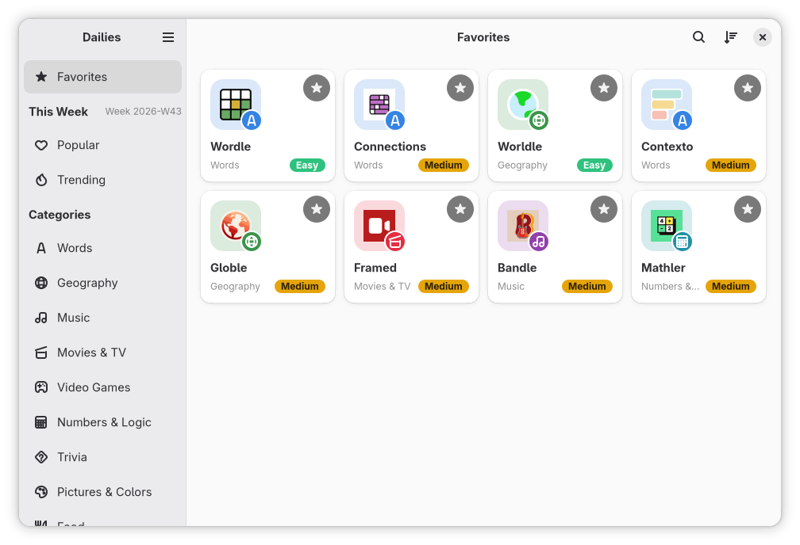
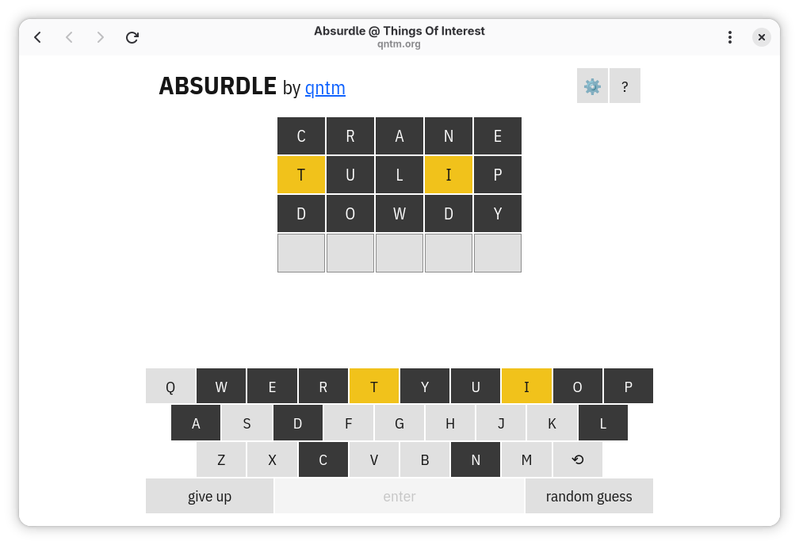
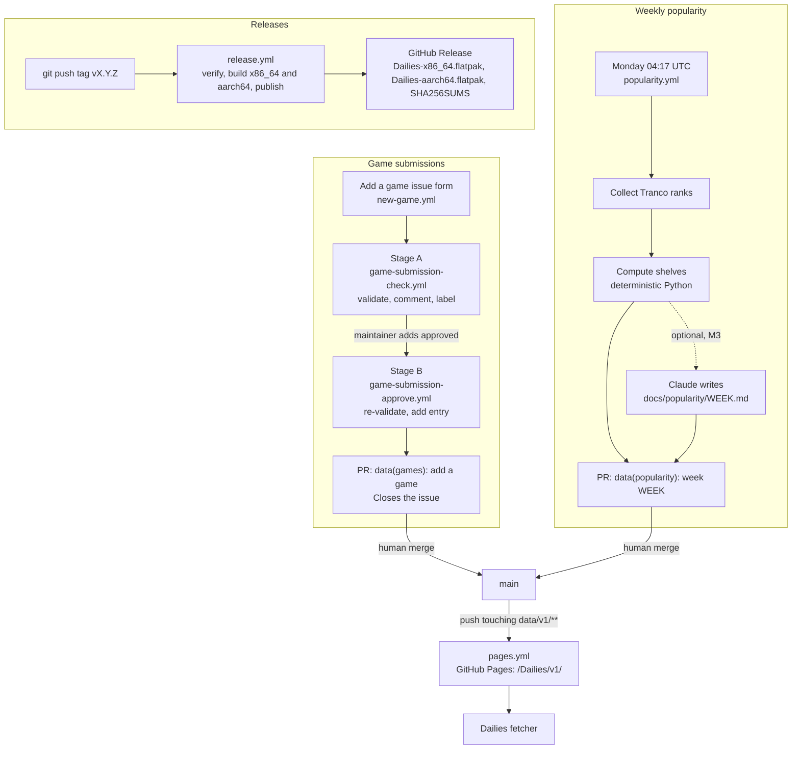

<div align="center">


# Dailies

Play your daily guessing games in one place

[Download](https://github.com/Tim-van-Oudheusden/Dailies/releases/latest) ·
[Add a game](https://github.com/Tim-van-Oudheusden/Dailies/issues/new?template=new-game.yml) ·
[buildwithtim.dev](https://buildwithtim.dev)

[](https://github.com/Tim-van-Oudheusden/Dailies/actions/workflows/ci.yml)
[](https://github.com/Tim-van-Oudheusden/Dailies/actions/workflows/coverage-gate.yml)
[](https://github.com/Tim-van-Oudheusden/Dailies/releases)
[](LICENSE)
[](https://github.com/Tim-van-Oudheusden/Dailies/commits/main)

</div>

<p align="center">
  
  
</p>

<p align="center">
  <a href="https://youtu.be/LrEyWpnOZiE"></a>
  <br>
  <a href="https://youtu.be/LrEyWpnOZiE">Watch the introduction video on YouTube</a>
</p>

## Status

Early: releases are still 0.x, and the newest is on the
[Releases](https://github.com/Tim-van-Oudheusden/Dailies/releases/latest) page. Linux only, as a Flatpak; not on
Flathub yet.

## About

A GNOME app that lists daily guessing games ("-dles") such as Wordle, Connections and Worldle, and opens them.

- **One window for every daily game.** More than a hundred games, sorted into ten categories from words and logic to
  music, movies and geography. Search with Ctrl+F.
- **This week's shelves.** Popular and Trending show which games are popular right now and which are on the rise,
  computed every Monday from the [Tranco](https://tranco-list.eu) rank of each game's site.
- **Favorites.** Star the games you play every day (or press Ctrl+D) to keep them together at the top of the sidebar.
- **A built-in browser that remembers you.** Games open in a WebKitGTK page that keeps logins and streaks between
  sessions, or in your default browser, or through a command of your choice.
- **No account, no tracking.** Favorites stay on your device. Dailies downloads only the game list and the game pages
  you open, and a bundled copy of the list means it works offline from the first start.

## Installing

Pick one:

- **Download a release.** Each release on the [Releases](https://github.com/Tim-van-Oudheusden/Dailies/releases) page
  attaches `Dailies-x86_64.flatpak`, `Dailies-aarch64.flatpak` and `SHA256SUMS`. The bundle needs the GNOME 51 runtime,
  which Flatpak installs from Flathub, so add the Flathub remote first:

  ```sh
  flatpak remote-add --if-not-exists --user flathub https://dl.flathub.org/repo/flathub.flatpakrepo
  flatpak install --user ./Dailies-x86_64.flatpak     # or Dailies-aarch64.flatpak
  ```

  Bundles do not update themselves. Install the next release over the old one; your favourites and settings stay.
- **Download a CI build.** Every CI run uploads a Devel bundle of the latest code as the
  `io.github.tim_van_oudheusden.Dailies.Devel-x86_64.flatpak` artifact. Open a recent run of the
  [`CI` workflow](https://github.com/Tim-van-Oudheusden/Dailies/actions/workflows/ci.yml) (you must be signed in to
  GitHub), download the artifact, unzip it, and run
  `flatpak install --user ./io.github.tim_van_oudheusden.Dailies.Devel-x86_64.flatpak`. The Devel build has its own app
  ID, striped header bar and icon, and installs next to a release with separate settings and website data.
- **Build from source.** Follow [Getting started](CONTRIBUTING.md#getting-started) in `CONTRIBUTING.md`, then:

  ```sh
  git clone https://github.com/Tim-van-Oudheusden/Dailies.git
  cd Dailies
  scripts/dev.sh build-devel   # build the Devel manifest and install it for your user
  scripts/dev.sh run           # run it
  ```

### Custom browser command

Games open in the built-in browser by default, or in your default browser through the OpenURI portal; neither needs an
extra permission. A third mode, **Custom command**, runs a command of your choice on the host (a particular browser or
browser profile, such as `firefox --new-window`) with the game's URL appended as its last argument; no shell
interprets it. From inside the Flatpak sandbox that needs host access, which Dailies never asks for. Grant it yourself:

```sh
flatpak override --user --talk-name=org.freedesktop.Flatpak io.github.tim_van_oudheusden.Dailies
```

> [!WARNING]
> **This is a sandbox escape that you choose.** Access to `org.freedesktop.Flatpak` lets Dailies run any command on your
> host as your user, outside the sandbox. Only grant it if you accept that.

Restart Dailies, then choose **Custom command** under **Preferences → Opening games** and enter the command; until the
access is granted the mode is hidden and inert. To take the access back:

```sh
flatpak override --user --no-talk-name=org.freedesktop.Flatpak io.github.tim_van_oudheusden.Dailies
```

For the Devel build, use `io.github.tim_van_oudheusden.Dailies.Devel` in both commands.
[Custom browser command](CONTRIBUTING.md#custom-browser-command) in `CONTRIBUTING.md` has the details.

## Adding a game

Use the [Add a game](https://github.com/Tim-van-Oudheusden/Dailies/issues/new?template=new-game.yml) issue form; you
do not need to edit `data/v1/games.json` yourself. A workflow checks each submission automatically and comments on the
issue with the result. Once the maintainer approves it, a second workflow checks it again and opens a pull request that
adds the game to the catalog and closes the issue. What a game needs to get in (https, a new puzzle every day, playable
without an account or labelled as needing one, not a duplicate) is in
[Submission rules](docs/data-format.md#submission-rules) in `docs/data-format.md`.

## Game icons

Each game's icon is its site's own icon (the web-app manifest icon, the `apple-touch-icon` or the favicon), or else the
one Google or DuckDuckGo shows for the site, normalised to a 64×64 PNG by `scripts/icons/fetch_icon.py`. The icons are
published with the catalog on GitHub Pages under `v1/icons/`, are not part of the Flatpak, and remain the marks of
their owners; [Icons](docs/data-format.md#icons) in `docs/data-format.md` has the details. The app downloads an icon
from the same place as the game list, only for the games it shows, at most once a week and never on a metered
connection; it never contacts a game's site for its icon.

**Takedown.** If you run a listed game and want its icon removed, open an issue or reach the maintainer through
[Contact](#contact). The game's id goes into `scripts/data/icon-takedowns.txt`; the next fetch deletes the icon and
never downloads it again, and Dailies deletes its copy at the next game-list update and shows the game's category glyph
instead.

## Tech stack

- **App:** Python 3 with PyGObject, GTK 4.24, libadwaita 1.10, WebKitGTK 6.0 for the built-in browser, libsoup 3 for
  downloads; no third-party Python packages at runtime
- **UI:** Blueprint files compiled to GTK Builder XML at build time
- **Build and packaging:** Meson, Flatpak on the GNOME 51 runtime (`org.gnome.Platform//51`)
- **Data:** two JSON files in [`data/v1/`](data/v1/README.md), checked against JSON Schema in CI
- **Testing:** ruff, pytest with coverage floors, Meson tests and GTK tests inside the GNOME SDK
- **CI/CD:** GitHub Actions, GitHub Releases for the Flatpak bundles, Dependabot

## Architecture

```mermaid
flowchart LR
  subgraph bundled["Bundled snapshot: /app/share/dailies/data/v1"]
    BG["games.json"]
    BP["popularity.json"]
  end
  subgraph remote["GitHub: Pages, then raw.githubusercontent.com"]
    RG["games.json"]
    RP["popularity.json"]
  end
  subgraph cache["Cache: $XDG_CACHE_HOME/dailies/v1"]
    CG["games.json + .etag + .fetched"]
    CP["popularity.json + .etag + .fetched"]
  end
  remote --> F["data/fetcher.py<br/>libsoup 3, If-None-Match"]
  F --> cache
  bundled -.->|"first run or unreadable cache"| cache
  cache --> C["core/catalog.py<br/>parse, check, keep status"]
  cache --> P["core/popularity.py<br/>shelves and ranks"]
  C --> S["data/store.py<br/>Gio.ListStore of GameObject"]
  P --> S
  FAV["data/favorites.py<br/>GSettings key favorites"] --> S
  S --> FL["Gtk.FilterListModel<br/>ui/filters.py: section + search"]
  FL --> SO["Gtk.SortListModel"]
  SO --> GV["Gtk.GridView<br/>GameTile per game"]
  GV -->|"activate"| OP["ui/opener.py<br/>in-app, external or custom"]
  OP --> WK["ui/browser_page.py<br/>WebKit.WebView"]
  OP --> UL["Gtk.UriLauncher<br/>OpenURI portal"]
```



The app reads the bundled snapshot on first start, then revalidates both files from GitHub with ETags. Everything that
works without GTK (parsing, popularity, search) lives in `dailies/core` and is tested with plain pytest; `dailies/data`
and `dailies/ui` are thin layers over GLib and GTK.



Data changes and releases both end in something a human merges or tags: the weekly popularity job opens a numbers-only
pull request, and `pages.yml` publishes `data/v1/` to GitHub Pages, which the app tries before
`raw.githubusercontent.com`. A game submission ends the same way: when the maintainer labels a checked submission
`approved`, stage B validates it again and opens a `data(games): add <name>` pull request that closes the issue
([Approving game submissions](CONTRIBUTING.md#approving-game-submissions)). More in
[`docs/architecture.md`](docs/architecture.md).

## Documentation

| Document | Covers |
| --- | --- |
| [`docs/architecture.md`](docs/architecture.md) | Runtime data flow, modules, caching, opening games, data and release pipelines, decisions, measurements |
| [`docs/data-format.md`](docs/data-format.md) | `games.json` and `popularity.json`: fields, categories, difficulty, submission rules, licences |
| [`CONTRIBUTING.md`](CONTRIBUTING.md) | Setup, project layout, workflow, quality gates, releasing |
| [`docs/testing.md`](docs/testing.md) | Where each test runs, coverage floors, headless GTK tests |
| [`docs/risk-tiers.md`](docs/risk-tiers.md) | How pull requests are classified by risk |
| [`docs/runbooks/README.md`](docs/runbooks/README.md) | What to do when something breaks |
| [`docs/metrics/README.md`](docs/metrics/README.md) | Quality, coverage and agent-work metrics |
| [`SECURITY.md`](SECURITY.md) | Supported versions and how to report a vulnerability privately |
| [`docs/security/SECURITY-AI.md`](docs/security/SECURITY-AI.md) | Security model for AI agents in this repository |
| [`BRANDING.md`](BRANDING.md) | Name, voice, colours and icon |
| [`docs/README.md`](docs/README.md) | Index of the research, proposals and plans behind the design |

## Contributing

See [`CONTRIBUTING.md`](CONTRIBUTING.md) for setup, project layout and the quality gates. AI agents follow
[`AGENTS.md`](AGENTS.md).

## Acknowledgments

- [Cartridges](https://codeberg.org/kramo/cartridges) by kramo, the GNOME game launcher whose Python, Blueprint and
  Meson setup and library layout Dailies follows.
- [Bazaar](https://gitlab.gnome.org/World/bazaar), for its Flatpak packaging and release patterns.
- [The Dles](https://dles.aukspot.com) by aukspot ([source](https://github.com/aukspot/dles), GPL-3.0), whose catalog
  helped check the seed list of games.
- [Tranco](https://tranco-list.eu), the research-oriented domain ranking the popularity shelves are built on.

## Disclaimer

Dailies is not affiliated with The New York Times, Merriam-Webster, LinkedIn or any game listed. Game names and icons
are trademarks of their owners; Dailies only opens their public websites and shows their icons to identify them.

## Contact

- [GitHub](https://github.com/Tim-van-Oudheusden)
- [LinkedIn](https://www.linkedin.com/in/tim-van-oudheusden)
- [buildwithtim.dev](https://buildwithtim.dev)
- Other projects: [MinimalUI](https://github.com/Tim-van-Oudheusden/MinimalUI), a minimal Android launcher for
  keyboard-centric phones, and [website](https://github.com/Tim-van-Oudheusden/website), the source of buildwithtim.dev

## Licence

| Path | Licence |
| --- | --- |
| Code and everything not listed below | [GNU General Public License v3.0 or later](LICENSE) |
| `data/io.github.tim_van_oudheusden.Dailies.metainfo.xml.in` | [CC0 1.0](https://creativecommons.org/publicdomain/zero/1.0/) |
| `data/v1/games.json` and `data/v1/schema/` (the catalog) | [CC0 1.0](https://creativecommons.org/publicdomain/zero/1.0/) |
| `data/v1/popularity.json` | Reuse with the credit lines in its `attribution` array ([Licences](docs/data-format.md#licences)) |
| `data/v1/icons/` | Not licensed by Dailies: the games' own logos and favicons, marks of their owners ([Icons](docs/data-format.md#icons)) |
