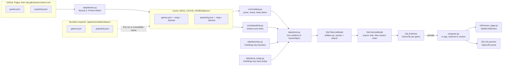
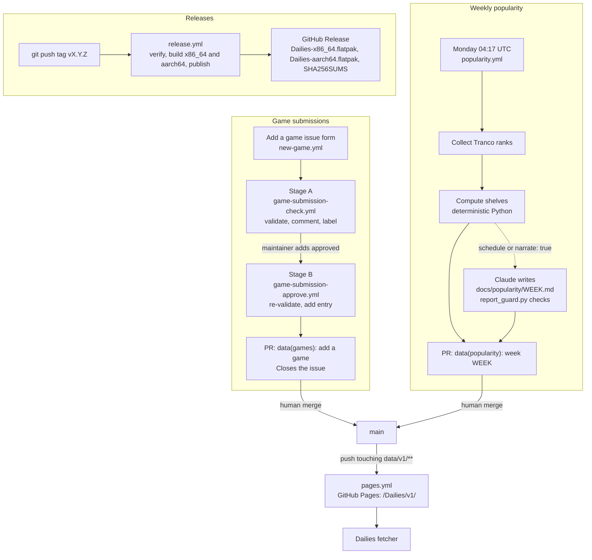

# Architecture

How Dailies is put together: the runtime, the data it reads, the pipelines that produce that data and the releases,
and the decisions behind them. This is the [MVP-first proposal](proposals/mvp-first.md) trimmed to the design being
built; the proposal keeps the research citations, the alternatives that were weighed and the full roadmap. The JSON
files are specified in [`data-format.md`](data-format.md).

> **Status (M0).** What exists today: the repository scaffold (`pyproject.toml`, ruff settings, the `tests/` skeleton),
> the agent and contributor docs, the issue forms (including the **Add a game** form), and the catalog data with its
> schemas and data tests (`data/v1/`). Everything else on this page, including the `dailies/` application package, the
> Meson build, the Flatpak manifests, the GSettings schema, `scripts/` and every GitHub Actions workflow, is the design
> being built and lands with the M1 issues (the submission and popularity automation with M2). Until then this page
> describes a plan, not shipped code, and the **Measurements** section is empty.

## Overview

Dailies is a GNOME app that lists daily guessing games ("-dles") and opens them. It is Python 3 with PyGObject,
GTK 4 and libadwaita, with the UI written in Blueprint and built with Meson, packaged as the Flatpak
`io.github.tim_van_oudheusden.Dailies` on `org.gnome.Platform//51`. It has no third-party Python dependencies at
runtime: HTTP is libsoup 3, JSON is the standard library, images are GTK.

The window is an `Adw.NavigationSplitView`: a sidebar (Favorites first, then this week's Popular and Trending shelves,
then ten fixed categories) beside a grid of game tiles, each with a star to pin it to Favorites. A game opens in a
built-in WebKitGTK page by default ([#9][issue-9]) or in the system browser through the OpenURI portal.

The data is two JSON files in this repository, `data/v1/games.json` (the catalog) and `data/v1/popularity.json` (the
weekly shelves). A snapshot ships inside the Flatpak so the app works offline from the first start; the app revalidates
it from GitHub with ETags. Games enter the catalog through a GitHub issue form; popularity is recomputed by a Monday
workflow. Both end in a pull request a human merges. Releases are `.flatpak` bundles for x86_64 and aarch64, built
when a `v*` tag is pushed.

| Layer | Choice |
|---|---|
| Language | Python ≥ 3.12 with PyGObject (3.58 in the GNOME 51 SDK) |
| UI | GTK 4.24 and libadwaita 1.10 (Meson floors), Blueprint 0.22 `.blp` files compiled to `.ui` at build time |
| Build | Meson ≥ 1.4 with a `profile` option: `release` builds the app ID, `development` builds `<id>.Devel` |
| Runtime | `org.gnome.Platform//51` and `org.gnome.Sdk//51`, no SDK extensions |
| HTTP | libsoup 3 (`Soup.Session`) through GObject introspection, conditional GET with `If-None-Match` |
| JSON | standard-library `json`; the app does a structural check, full JSON Schema validation happens in CI |
| Built-in browser | WebKitGTK 6.0, already in the Platform, imported lazily (`HAVE_WEBKIT` is false when it is missing) |
| External browser | `Gtk.UriLauncher` (OpenURI portal), falling back to `Gio.AppInfo.launch_default_for_uri_async` |
| Lint and tests | ruff (check and format), pytest with coverage, Meson tests for the desktop file, metainfo, schema and Blueprint |

## Runtime data flow



### Modules

The package splits into `core/` (pure Python, never imports `gi`), `data/` (thin wrappers over GLib, GIO and libsoup)
and `ui/` (GTK and libadwaita). Catalog parsing, popularity maths and search therefore run under plain pytest on any
machine, and the coverage floors apply to `dailies/core` and `scripts/` only.

| Module | Uses `gi` | Responsibility |
|---|---|---|
| `core/models.py` | no | Frozen `Game` dataclass; `Category` enum (ten ids, display names, glyph names); `Difficulty` enum. An unknown category maps to `trivia` so a newer catalog never crashes an older app |
| `core/catalog.py` | no | `parse(bytes) -> Catalog`: structural check (`schema_version == 1`, required keys, tolerant enums), `is_newer()` by `generated_at`; hides entries whose `status` is not `active` but keeps them so favourites still resolve |
| `core/popularity.py` | no | `parse(bytes) -> Popularity` (week, `valid_until`, `popular`, `trending`), `rank_of(id)`, `is_stale(now)` |
| `core/search.py` | no | Ranked, case- and accent-folded matching over name, description, tags and category label: name prefix > word starts ("t m c" for The Mini Crossword) > name substring > other fields > one typo from six letters, two from nine; whether a new query narrows or widens the matches (a query that may match with a typo always re-tests every game) |
| `core/sections.py` | no | The sidebar's section ids (Favorites, Popular, Trending, then the category ids), which categories have active games, the section to restore, the "as of" date of stale shelves; what each section holds, the sort keys (shelf rank, favourite order, name, or the `sort-mode` override, including "not done first"), the moves a favourite can make there, the empty-state page, the tiles' colour classes |
| `core/done_today.py` | no | The "Done today" marks (game id → local `YYYY-MM-DD`): `is_done`, `prune` (only today's marks are kept), `toggle`, `mark`, the seconds until local midnight, and `AUTO_MARK_SECONDS` (60) for the automatic mode |
| `core/reorder.py` | no | Reordering favourites: `moved()` (an id to an index), the destination of Move Up, Move Down and Move to Top (`None` when impossible) and of a drop before or after another favourite |
| `core/cache.py` | no | The cache directory (`<name>.json`, `.etag`, `.fetched`, atomic writes) and the decisions of one refresh: skip while younger than the maximum age, `If-None-Match`, fall-through order of the data URLs, `Retry-After` backoff, validate before writing; the stale-banner rule |
| `core/favorites_file.py` | no | The favourites export file (see [Exporting favourites](#exporting-favourites)): `dump`, `parse` (raises `FavoritesFileError` on anything but a valid version-1 file) and `combine` for Merge and Replace |
| `data/fetcher.py` | Soup, Gio, GLib | Thin asynchronous libsoup 3 shell over `core/cache.py`: one `Soup.Session` with `User-Agent: Dailies/<version> (+https://github.com/Tim-van-Oudheusden/Dailies)` sends the requests a refresh asks for, one at a time, and never retries in a loop |
| `data/favorites.py` | Gio, GLib | Wraps the `favorites` string-array key: `is_favorite`, `toggle`, `add`, `move` (one key write per move), order (newest last), `set_order`, `import_ids`; emits `changed(id)`. `export` and `read_export` write and read the export file with Gio's asynchronous file I/O |
| `data/done_today.py` | Gio, GLib | Wraps the `done-today` key: `is_done`, `toggle`, `mark`, `refresh()`; prunes earlier days at startup and at local midnight (a GLib timeout, re-armed each day); emits `changed(id)` |
| `data/store.py` | Gio | Owns the `Gio.ListStore` of `GameObject`; applies catalog, popularity, favourites and the done-today marks; `reload()` diffs by id so the grid keeps its scroll position |
| `ui/game_object.py` | GObject | `GameObject` with `game`, `name`, `category-label`, `difficulty-label`, `caption`, `available`, `favorite`, `popular-rank`, `trending-rank` and `done` properties for Blueprint bindings and filters, and `in-favorites`, `can-move-up` and `can-move-down`, which the window sets for the tile's menu and drag-and-drop |
| `ui/filters.py` | Gtk | `SectionFilter` (Favorites, Popular, Trending or a category) and `SearchFilter`, combined in a `Gtk.EveryFilter`; `SectionSorter` orders shelves by rank, Favorites by favourite order, categories by name; `SearchSorter`, first in a `Gtk.MultiSorter`, puts the best matches first while a query is active and leaves the section order otherwise |
| `ui/tile.py` | Gtk, Adw | `GameTile`: a `.card` button (tinted category glyph, name, category, difficulty pill, a "Done today" badge on a dimmed card; screen readers hear "Name, Category · Difficulty") with an overlaid star toggle, never a button inside a button; `game_menu()` builds the tile's context menu (right click, long press, Shift+F10 or Menu); in Favorites, the drag source and drop target that reorder favourites |
| `ui/library.py` | GLib | The library's translated texts: category and difficulty names, tile captions, the This Week subtitle, the stale banner |
| `window.py` | Adw | Window, sidebar, grid, search bar, empty states, toasts; `open_game()` is the one way a game is opened |
| `ui/browser_page.py` | WebKit | The in-app browser page; only imported when `HAVE_WEBKIT` |
| `ui/opener.py` | Gtk, Gio | Turns the `open-mode` setting into an action (see [Opening games](#opening-games)) |
| `ui/preferences.py` | Adw | `Adw.PreferencesDialog`: open mode, website data, catalog options |
| `ui/favorites_transfer.py` | Gtk, Adw | Export Favorites… and Import Favorites… (`app.export-favorites`, `app.import-favorites`): `Gtk.FileDialog`, the Merge/Replace `Adw.AlertDialog` and the result toasts |
| `application.py` | Adw | `Adw.Application`, its actions and accelerators, the `.devel` style in the Devel build, the About dialog read from the metainfo |
| `config.py.in` | none | `APP_ID`, `VERSION`, `PROFILE`, `PKGDATADIR`, `DATA_URLS`, `LOCALEDIR`, filled in by Meson |

### Startup sequence

1. `Store.load_initial()` reads `$XDG_CACHE_HOME/dailies/v1/games.json`. If it is missing, does not parse or is older
   than the bundled `PKGDATADIR/data/v1/games.json`, the bundled file is copied into the cache first. The same happens
   for `popularity.json`. The grid is filled before the window is shown; the files are tens of kilobytes, so there is
   no spinner.
2. After the window maps, `Fetcher.refresh_all()` runs asynchronously. For each file whose last fetch is older than its
   maximum age (catalog 6 h, popularity 24 h) it sends a conditional GET. A `304` only updates the fetch time; a `200`
   is parsed, written with its ETag and fetch time, and followed by `Store.reload()`; any failure is logged and the old
   data stays. On a metered connection (`Gio.NetworkMonitor`) the refresh is skipped.
3. An `Adw.Banner` reading "Showing the game list from *date*" appears only when the last successful fetch is older
   than 14 days and the machine is online, so a fresh install without network stays quiet. Popular and Trending carry
   the subtitle "Week 2026-W42", or "Week 2026-W42 (as of *date*)" once `valid_until` has passed; the shelves are shown
   either way.
4. **Refresh Game List** (primary menu, Ctrl+R in the library) forces a revalidation and reports the result in a toast.

### Caching and offline behaviour

| Item | Location | Policy |
|---|---|---|
| Catalog and popularity | `$XDG_CACHE_HOME/dailies/v1/`, inside the Flatpak `~/.var/app/<id>/cache/dailies/v1/` | Seeded from the bundled snapshot; conditional GET every 6 h (catalog) and 24 h (popularity); the last good copy is kept on any failure; fully usable offline |
| Website data of the built-in browser | `$XDG_DATA_HOME/dailies/web/shared/` (or `web/games/<id>/` per game) and the matching cache directories | Persistent `WebKit.NetworkSession` per session directory with its own SQLite cookie file (`cookies.sqlite`), so logins and streaks survive a restart; cleared from Preferences (every session, also ones not opened since the app started), or on exit when enabled |
| Favourites, done-today marks, preferences, window state | GSettings | Stored by GLib; inside the Flatpak in `~/.var/app/<id>/config/glib-2.0/settings/keyfile`; nothing leaves the device |
| Game icons | none | Category glyphs bundled in the GResource |

### Settings

GSettings schema `io.github.tim_van_oudheusden.Dailies` (the Devel build gets its own ID and path):

| Key | Type | Default | Meaning |
|---|---|---|---|
| `favorites` | `as` | `[]` | Favourite game ids in display order |
| `open-mode` | enum `in-app`, `external`, `custom` | `in-app` ([#9][issue-9]) | How a game opens |
| `external-browser-command` | `s` | `''` | Host command for `custom`; inert unless the user granted host access |
| `clear-web-data-on-exit` | `b` | `false` | Clear the built-in browser's website data when the app quits |
| `sort-mode` | enum `default`, `name`, `difficulty`, `not-done` | `default` | `default` is shelf rank, favourite order or name, depending on the section; `not-done` is the default order with the games done today last |
| `show-other-languages` | `b` | `true` | Show games whose language differs from the system locale |
| `done-today` | `a{ss}` | `{}` | Game id → local date (`YYYY-MM-DD`) it was marked as done; only today's marks count, the others are pruned at startup and at midnight |
| `auto-done-today` | `b` | `false` | Mark a game as done once it has been open in the built-in browser for 60 seconds |
| `session-isolation` | enum `shared`, `per-game` | `shared` | `shared`: one session for all games (v0.1); `per-game`: a session per game in `web/games/<id>`. Switching moves no data, so games need to sign in again |
| `cookie-policy` | enum `always`, `never`, `no-third-party` | `always` | `WebKit.CookieAcceptPolicy` of every session; `always` keeps third-party log-in flows working |
| `itp-enabled` | `b` | `false` | Intelligent Tracking Prevention; while on, WebKit ignores `no-third-party` |
| `hardware-acceleration` | enum `always`, `never` | `always` | `always` leaves WebKit's own choice (on where the system supports it); `never` forces `HardwareAccelerationPolicy.NEVER` |
| `user-agent` | `s` | `''` | Compatibility fixes only; empty keeps WebKit's user agent with `Dailies/<version>` appended. Never set by default |
| `developer-extras` | `b` | `false` | The Web Inspector (Inspect Element in the page's context menu) |

A `State` child schema keeps `width`, `height`, `is-maximized`, `last-section` and `first-run-banner-dismissed`. The
relocatable `Game` schema lives at `<schema path>/games/<id>/` for each catalog id (`core/web.py: game_settings_path`):
`open-mode-override` (`s`, `''`: an `open-mode` nick that replaces it for this game; empty or unknown uses
`open-mode`) and `isolated-session` (`b`, `false`: a session of its own for this game even while games share one).
Preferences has no rows for them yet; inside the Flatpak set one with `flatpak run --command=gsettings <app id> set
<app id>.Game:/io/github/tim_van_oudheusden/Dailies/games/wordle/ isolated-session true`. New keys are additive and
need no migration.

### Exporting favourites

The primary menu's **Export Favorites…** writes the favourites, in display order, to a file the user picks:

```json
{
  "schema_version": 1,
  "favorites": [
    "worldle",
    "connections"
  ]
}
```

UTF-8, 2-space indented. Both file choosers are `Gtk.FileDialog`, which goes through the FileChooser portal inside
the Flatpak, so no `--filesystem` permission is needed. **Import Favorites…** checks the whole file first: malformed
JSON, another `schema_version`, a `favorites` that is not a list, an id that is not a non-empty string, or an id listed
twice shows "This file is not a Dailies favorites export" and changes nothing. With favourites already set, an
`Adw.AlertDialog` offers **Merge** (the default: keep the current order and append the file's ids not among them) or
**Replace** (take the file's list); then a toast says "Imported N favorites". Ids the catalog does not know are kept
and resolve once the catalog has them.

### Window

`Adw.ApplicationWindow` → `Adw.ToastOverlay` → `Adw.NavigationView` with a `library` page (the split view) and a
`browser` page pushed when a game opens in-app. A popped browser page keeps its tag until its slide-out ends, so a game
opened before then removes it first (cutting the animation short) and pushes a fresh page. The sidebar is an
`Adw.Sidebar`; below 500 sp the split view collapses. The content is an `Adw.ToolbarView` with sort and search buttons,
a `Gtk.SearchBar` (Ctrl+F) and a stack of the grid and `Adw.StatusPage` empty states. Every user-facing string goes
through gettext; the widgets are current libadwaita API only.

Toasts follow one policy: sentence case without a trailing period, the default 5 s timeout, and **Undo** for every
reversible action (removing a favourite puts it back where it was). Irreversible actions say so without a button
("Website data cleared"). A game or a script pop-up that opens in the default browser shows "Opened in your browser",
with **Open Here** to load it in the built-in browser when WebKit is available (`core/opening.py: notice`,
`offers_open_here`). Leaving the library for the browser page dismisses all toasts (`dismiss_all`), so an undo for the
library does not linger over a game.

**Done today** ([#76][issue-76]) marks the games the user has played today, by the local calendar day, and never
leaves the device. A game is marked from its tile's menu (right click, long press, Shift+F10 or Menu on the focused
tile: **Mark as Done Today** / **Mark as Not Done**), from the built-in browser's page menu (a **Mark as Done Today**
check for the game shown) or, with the off-by-default **Mark games as done automatically** preference
(`auto-done-today`), once the game has stayed open in the built-in browser for 60 seconds (`AUTO_MARK_SECONDS`: a quick
look or a misclick doesn't count, the quickest dailies take longer). A marked tile shows a "Done today" check badge on a
dimmed card, and screen readers hear "…, done today". The **Not Done First** sort keeps the section's order with the
done games last. The marks expire at local midnight: `data/done_today.py` sets a GLib timeout for the next midnight,
and because that timer runs on the monotonic clock (it stops during a suspend, and ignores clock and time-zone
changes) the window also re-checks the day whenever it becomes active. The tile menu is built by one function,
`ui/tile.py: game_menu()`, one section per concern.

In Favorites the tile menu also holds **Move Up**, **Move Down**, **Move to Top** (disabled when the move is
impossible) and **Remove from Favorites**; Ctrl+Up and Ctrl+Down move the focused favourite, and the focus stays on it
after a move. A favourite can also be dragged onto another: dropped on the first half of a tile it goes before it, on
the second half after it, and an accent bar on that side shows where. Every move rewrites the `favorites` key once.
Moves are only offered while Favorites shows its own order: sorted by name, difficulty or not done first, the menu's
moves are disabled and nothing can be dragged.

## Opening games

The brief's order of preference is "configured browser, then built-in browser, then external browser". Inside a Flatpak
a *specific* host browser can only be started with `--talk-name=org.freedesktop.Flatpak`, which Flatpak documents as a
sandbox escape. Dailies therefore maps the brief onto what the sandbox allows without that permission, and leaves the
escape to the user.

```text
mode = game["open-mode-override"] or settings["open-mode"]
if mode == custom and host access granted and command != "":
    flatpak-spawn --host -- <argv…> <url>    # only after the user ran `flatpak override --talk-name=...`
elif mode in (in-app, custom) and HAVE_WEBKIT:
    push BrowserPage(url)                    # built-in browser
else:
    Gtk.UriLauncher(url).launch(window)      # OpenURI portal, host default browser
    on error: Gio.AppInfo.launch_default_for_uri_async(url)
```

- Host access is probed once per session, the first time the custom mode or Preferences needs it (`ui/opener.py`):
  a call to `org.freedesktop.Flatpak.Development.HostCommand` on the session bus with no arguments, which can never
  run anything. Observed with Flatpak 1.18.4: without the override the sandbox's D-Bus proxy answers
  `org.freedesktop.DBus.Error.ServiceUnknown`; with it `flatpak-session-helper` answers
  `org.freedesktop.DBus.Error.InvalidArgs` (`Type of message, “()”, does not match expected type
  “(ayaaya{uh}a{ss}u)”`). Only `InvalidArgs` counts as granted (`core/opening.py: host_access_granted`); every other
  outcome, `AccessDenied` included, means not granted.
- Outside Flatpak (no `/.flatpak-info`) the custom command is always available and runs directly through
  `Gio.Subprocess`. The command is split with `GLib.shell_parse_argv` and the URL appended as one more argv element
  (`core/opening.py: custom_command_argv`); no shell runs, so `;`, `$()`, backticks and spaces in a URL stay literal.
  A command that does not parse or start falls back like an unavailable one, and the toast "Custom command
  unavailable — opened in …" says so once per session.
- **Custom command** is hidden in Preferences until access is detected, and **Built-in browser** is hidden when WebKit
  is missing; while **Custom command** is chosen a monospace **Command** entry row (applied with its apply button)
  shows. [`CONTRIBUTING.md`](../CONTRIBUTING.md#custom-browser-command) and the
  [README](../README.md#custom-browser-command) have the `flatpak override` lines.
- While games open in-app, the library shows a first-run `Adw.Banner` ("Games open inside Dailies…") with a
  **Preferences** button; pressing it, or opening a game in-app, dismisses it for good (`first-run-banner-dismissed`).
- WebKit is imported the first time a game opens or Preferences needs to know, never at startup.
- Every in-app page has **Open in Browser** (Ctrl+Shift+O) and **Copy Link** in its menu.
- The built-in page is an `Adw.NavigationPage` with back, forward, reload and a title showing the page title and host.
  By default one `WebKit.NetworkSession` is shared by all games (sibling games share a login). With
  `session-isolation` `per-game`, or a game's `isolated-session`, the game gets
  `WebKit.NetworkSession.new(<data>/web/games/<id>, <cache>/web/games/<id>)` instead (`core/web.py: session_dir`;
  ids that are not catalog ids share), made once per run and cached by directory. Opening a game whose session
  differs from the shown page's replaces that page at once (`AdwNavigationView.replace`), and a page popped a moment
  ago that still slides out is removed before a new one is pushed, so two pages never hold the `browser` tag; a pop-up
  brought back with **Open Here** loads in the shown page's session. Every session stores its cookies persistently in
  its own `cookies.sqlite` and follows `cookie-policy` and `itp-enabled` live; `hardware-acceleration`, `user-agent` and
  `developer-extras` apply to pages opened next. TLS errors fail; downloads are cancelled and handed to the external
  browser; permission requests are denied; WebRTC and `data:` top-level navigation are off; `target="_blank"` links
  load in the same view, while script pop-ups (`window.open`) and unsupported file types go to the external browser.
  There are no injected scripts or styles, no ad blocking and no user-agent spoofing: `user-agent` is empty unless the
  user sets it for a compatibility fix. One `WebView` lives at a time, in a `WebKit.WebContext` of its own; when its
  page is popped the view is closed and dropped with its context, which ends its web processes (the network sessions
  stay). Ctrl+R reloads while the page is shown and refreshes the game list on the library.
- Preferences → Built-in browser has a **Privacy and compatibility** expander row with the six browser keys; the
  website-data row says that switching moves no data and games will need to sign in again. **Clear website data…**
  clears every session: the shared one and every `web/games/<id>` directory on disk, opened in this run or not.

## Data and release pipelines



**Game submissions.** Issues from the **Add a game** form go through two workflows. Stage A
(`game-submission-check.yml`) runs on `issues: opened/edited` with a read-only contents token, passes form values to
the validator only through `env:`, and checks: https only, the host resolves to a public address, the URL answers
within 10 s and five redirects, the final registrable domain equals the submitted one, no blocklisted title, no
duplicate URL, id or alias, and the candidate entry passes the schema. Stage B (`game-submission-approve.yml`) runs
when an owner, member or collaborator adds `approved`; anyone else adding the label starts nothing. It validates again
rather than trusting stage A (the issue may have been edited since); an invalid submission gets a comment and no pull
request. Otherwise `scripts/add_game.py` inserts the entry sorted by id, bumps `generated_at` and keeps the file's
formatting, so the diff is the new entry plus that one line; the whole catalog is checked with `check-jsonschema` and
`pytest tests/data`, and `data/add-<slug>` becomes a pull request `data(games): add <name>` that closes the issue.
Pull requests opened with `GITHUB_TOKEN` start no CI, so the required checks never appear and the maintainer merges
with the ruleset's admin bypass, on the strength of stage B's checks. A weekly link check (Sundays, in the nightly
compliance workflow) opens one issue listing broken entries, and a `data/link-status` pull request with the `status`
change once a game failed the same check two weeks in a row (or passed again two weeks in a row, or was hijacked to a
gambling page), never a deletion; the maintainer merges it.

**Popularity.** Numbers are computed by deterministic Python; a language model may only write prose. The only source in
the MVP is the Tranco rank of each game's registrable domain, smoothed over seven days and log-scaled; every game on a
domain gets its full score, and a shelf holds at most two games of one domain, picked in the order of
`data/v1/domain_weights.json`. `popular` holds the top `max(5, min(12, 10 % of active games))`; `trending` holds rising
games outside the top five, topped up with the newest games (`reason: "new"`) so the shelf is never empty. If Tranco
fails for more than 20 % of domains the job fails and the old file stays. Wikipedia pageviews, Hacker News story
counts and Cloudflare Radar buckets are optional collector flags, off by default ([#78][issue-78]); see
[`data-format.md`](data-format.md#how-method_version-3-is-computed). The current `popularity.json` is hand-written
(`method_version: 0`).

**Publishing.** `pages.yml` publishes `data/v1/` (schemas included) and `docs/popularity/` to GitHub Pages at
`https://tim-van-oudheusden.github.io/Dailies/v1/` on every push to `main` that touches them. The app tries that URL
first and falls back to `raw.githubusercontent.com` on a server error, a 429 or a network failure.

**Weekly report.** In the `publish` job of `popularity.yml`, `anthropics/claude-code-action` writes
`docs/popularity/<week>.md` from `summary.json` and `popularity.json`; it may write that one file and nothing else.
`scripts/popularity/report_guard.py` then fails the job unless `git status` shows only that report and a
`popularity.json` byte-identical to the `compute` artifact, and only then sets `report` to `../popularity/<week>.md`.
The step has `continue-on-error`, so a failed report still leaves the numbers-only pull request
([`docs/popularity/`](popularity/README.md), [`SECURITY-AI.md`](security/SECURITY-AI.md#the-popularity-report)).

**Releases.** See [Releasing in `CONTRIBUTING.md`](../CONTRIBUTING.md#releasing). The tag, `version:` in `meson.build`
and the newest metainfo `<release>` must agree, which the `verify` job checks before anything is built. Bundles do not
update themselves; a Flathub submission comes after at least three releases.

## Decisions

**Decision:** Python with PyGObject, not Rust or C. Why: the UI reference the owner named (Cartridges) is
Python, Blueprint and Meson; a launcher has no CPU-bound work; the data scripts are Python too, so app, tooling and
pipelines share one language. Rust adds compile times and binding crates to bump for no gain here; C (as in Bazaar) is
far more code for the same launcher. The fallback trigger to Rust is a measured cold start above about one second in
the Flatpak on a modern laptop (see [Measurements](#measurements)).

**Decision:** zero third-party Python dependencies at runtime. Why: libsoup, GLib, GTK and the standard library already
cover HTTP, JSON, settings and images. No pip module in the Flatpak means no `flatpak-pip-generator`, no generated
requirements module to keep current and a smaller supply chain. Tools only CI needs (`check-jsonschema` and the like)
live in `scripts/requirements.txt`, pinned with hashes; the app itself does a structural check instead of full JSON
Schema validation.

**Decision:** one JSON catalog file, not one YAML file per game. Why: at a few hundred entries a single
`games.json` stays under 100 KB, which is one HTTP round trip and one ETag; per-game files would add a second format and
a build step that concatenates them, for nothing a solo maintainer needs. Per-entry history lives inside the entry
(`history[]`) instead.

**Decision:** favourites live in GSettings (`favorites`, a string array), not in a JSON file. Why: the list is small,
needs no schema versioning, is stored by GLib in the app's sandboxed config directory and survives reinstalls, and
Cartridges shows collections in GSettings work well. Export and import can come later as a menu action writing JSON.

**Decision:** favourites are reordered in the `Gtk.GridView`, not in a `Gtk.FlowBox` ([#75][issue-75]). Why: each tile
carries its own `Gtk.DragSource` (the game id as a string) and `Gtk.DropTarget` (`str`, move), and a drop only rewrites
the `favorites` key; the section sorter re-sorts the model, so no widget is moved by hand and recycled tiles need no
bookkeeping. What a tile may do comes from `GameObject` properties the window keeps current (`in-favorites`,
`can-move-up`, `can-move-down`), since a tile does not know the section or the sort mode. A `FlowBox` would have made
`insert()` at an index trivial but meant a second grid with its own filtering, sorting and keyboard navigation.

**Decision:** games open in the built-in browser by default (`open-mode` `in-app`, [#9][issue-9]). Why: the built-in
browser is what sets Dailies apart from a bookmarks folder, and a shared session keeps logins and streaks across sibling
games. **Default browser** is one setting away, a first-run banner says so, and every in-app page has **Open in
Browser**. The rejected alternative was `external` by default, on publisher terms-of-service grounds.

**Decision:** releases are cut by pushing a `vX.Y.Z` tag ([#12][issue-12]), not by a push to `main` that changes a
version file. Why: a Flatpak release needs the metainfo release entry and the tag to exist together, and `v*` tags are
what the manifest's `x-checker-data` and a later Flathub manifest consume.

**Decision:** the manifest never requests `--talk-name=org.freedesktop.Flatpak`. Why: that permission lets the app run
any command on the host, Flatpak calls it a sandbox escape, and Flathub grants it only with strong justification.
Without it a specific host browser cannot be started, so the **Custom command** mode stays hidden and inert until the
user grants the permission with `flatpak override`, a choice they make knowingly. The finish-args are network, IPC,
fallback X11, Wayland, PulseAudio and DRI; no filesystem access and no D-Bus names.

**Decision:** the manifests request `--socket=pulseaudio` from the first release ([#16][issue-16]). Why: music games
(Bandle, Heardle Decades, Songless) play their clips in the built-in browser, and WebKitGTK has no other route to the
sound server. The socket is used for playback only; Dailies itself makes no sound.

**Decision:** `dailies/core` never imports `gi`. Why: parsing, ranking and search are then tested with plain pytest
on any runner in seconds, without the GNOME SDK; the GTK layers stay thin and are covered by the build checks and the
smoke test.

**Decision:** the icon is the "Daily Grid" calendar card with a Blue/Orange solved row ([#8][issue-8]), not the
genre's green and yellow. Why: the launcher gains nothing from Wordle's trade dress and loses a risk by avoiding it.

**Decision:** the catalog is a curated seed, and fan-made games based on someone else's IP are included with the
`fan-made` tag ([#10][issue-10]). Why: a curated list keeps quality and link health manageable for one maintainer, and
the tag makes a "hide fan-made games" filter trivial if takedowns become a problem.

**Decision (superseded by [#88][issue-88]):** games sharing a registrable domain split its Tranco score equally, unless
`data/v1/domain_weights.json` overrides the shares ([#13][issue-13]). Why it was dropped: `nytimes.com` is split nine
ways, so no New York Times game reached Popular, and even a 35 % share left Wordle below eleventh place
(`method_version: 1`).

**Decision:** every game gets its domain's full score, and Popular and Trending each hold at most two games of one
registrable domain ([#88][issue-88], `method_version: 2`). `domain_weights.json` keeps its format and checks but now
orders a domain's games (highest weight first, unlisted games last) instead of splitting the score. Why: Tranco ranks
domains, not pages; without a split the best domains' games show up, and the cap keeps one publisher from filling a
shelf. Rejected: no split without a cap (LinkedIn plus all nine NYT games), and 1/√n damping (still no NYT game).

**Decision:** Wikipedia, Hacker News and Cloudflare Radar are optional signals behind `collect.py` flags, off by default
([#78][issue-78]). With them, `popularity` is the weighted mean of the scores a game has (Tranco 0.80, Wikipedia 0.15,
HN 0.05, Radar 0.20), renormalised over the ones present, and the file is `method_version: 3`; without them it stays
byte-identical to `method_version: 2`. Why: Wikipedia covers only a handful of games and HN title search is noisy, so
neither may outvote Tranco or penalise a game for having no article; Radar needs a token and is CC BY-NC, so it must
be skippable, and a missing token or a source failing for more than 20 % of its items drops it with `ok: false` in
`sources` instead of failing the week.

## Measurements

To be filled in by [#52][issue-52] once the app builds as a Flatpak. Nothing here is measured yet. The proposal names
two numbers that decide things: cold-start time of the Flatpak (the Rust fallback trigger is about one second) and the
memory of the built-in browser with one game open (a New York Times game). #52 defines the method and records the
results here.

[issue-8]: https://github.com/Tim-van-Oudheusden/Dailies/issues/8
[issue-9]: https://github.com/Tim-van-Oudheusden/Dailies/issues/9
[issue-10]: https://github.com/Tim-van-Oudheusden/Dailies/issues/10
[issue-12]: https://github.com/Tim-van-Oudheusden/Dailies/issues/12
[issue-13]: https://github.com/Tim-van-Oudheusden/Dailies/issues/13
[issue-16]: https://github.com/Tim-van-Oudheusden/Dailies/issues/16
[issue-52]: https://github.com/Tim-van-Oudheusden/Dailies/issues/52
[issue-78]: https://github.com/Tim-van-Oudheusden/Dailies/issues/78
[issue-75]: https://github.com/Tim-van-Oudheusden/Dailies/issues/75
[issue-76]: https://github.com/Tim-van-Oudheusden/Dailies/issues/76
[issue-88]: https://github.com/Tim-van-Oudheusden/Dailies/issues/88
