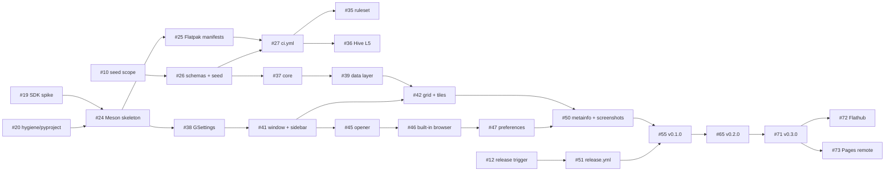

This is the master tracking issue for building Dailies. Every other issue in this set comes from [`docs/proposals/mvp-first.md`](https://github.com/Tim-van-Oudheusden/Dailies/blob/main/docs/proposals/mvp-first.md), with extra detail from the eleven reports in [`docs/research/`](https://github.com/Tim-van-Oudheusden/Dailies/blob/main/docs/research/README.md). Every requirement traces back to [`docs/BRIEF.md`](https://github.com/Tim-van-Oudheusden/Dailies/blob/main/docs/BRIEF.md).

> [!NOTE]
> The MVP-first proposal has **not been judged yet**. [`docs/plans/design-judge-plan.md`](https://github.com/Tim-van-Oudheusden/Dailies/blob/main/docs/plans/design-judge-plan.md) still lists two proposals, a judge panel and `docs/ARCHITECTURE.md`. If that process changes a decision, update the affected issues. The plan says to treat MVP-first as a valid proposal in the meantime, so this backlog follows it.

## What is being built

A GTK4/libadwaita launcher for daily "-dle" guessing games, Flatpak-first, written in **Python 3 + PyGObject + Blueprint + Meson** on `org.gnome.Platform//51`. The app ID is `io.github.tim_van_oudheusden.Dailies` and the app has **zero third-party Python runtime dependencies**.

- **Sidebar:** Favorites always first, then weekly Popular and Trending, then ten fixed categories.
- **Grid:** a model-driven `Gtk.GridView` of card tiles, each with a star toggle.
- **Opening games:** in a built-in WebKitGTK page or in the default browser via the portal. A user-granted custom-command mode comes in M2.
- **Data:** `data/v1/games.json` and `data/v1/popularity.json` are bundled as an offline snapshot and revalidated from GitHub with ETags.
- **Catalog growth:** game submissions arrive through an issue form and an IssueOps pipeline that opens PRs.
- **Popularity:** a Monday Tranco job opens a PR. From M3, Claude writes the prose of the weekly report; the numbers stay deterministic.
- **Repository:** Hive ACMM Codebase L5 from the first scaffold, copied from MinimalUI.

## How to read these issues

- **Labels:** `milestone::M0` … `milestone::M5`, `epic`, `decision`, `spike`, `type::feature|task|chore`, `priority::high|medium|low`, and the area labels `app`, `data`, `flatpak`, `ci`, `documentation`.
- **Dependencies:** each ticket ends with a **Dependencies** section. **Blocked by** lists what to finish first; **Blocks** lists what waits on this one. These are also recorded as native GitHub issue dependencies. Don't start a ticket while a blocker is open, unless the ticket marks that blocker as *soft*.
- **Decisions:** the `decision` issues (#8–#17) are the owner's open questions from proposal §18. Each one states the default proposed in the plan. If the owner doesn't object, close it with the default and its dependent tickets are unblocked.
- **Conventions:** every ticket follows the repo conventions copied from MinimalUI (proposal §2): Conventional Commit PR titles, branch `<type>/<number>-<slug>`, `Fixes #N` in the PR body, one commit per issue `type(scope): summary (#N)`, merge commits only, every action pinned to a 40-hex SHA with a `# vX.Y.Z` comment.
- **Evidence markers:** **[V]** / **[I]** / **[U]** in the proposal mean verified / inference / unverified. Tickets that rest on **[U]** facts say so and include the check.

## Milestones

| Epic | Milestone | Target | Exit criterion |
|---|---|---|---|
| #2 | **M0 Scaffold** | week 1 | Hive ACMM Eval shows Codebase **L5**; `Flatpak (x86_64)` CI green; `flatpak run io.github.tim_van_oudheusden.Dailies.Devel` opens a window |
| #3 | **M1 Usable launcher → v0.1.0** | weeks 2–3 | Tag `v0.1.0`; GitHub Release with `Dailies-x86_64.flatpak`, `Dailies-aarch64.flatpak`, `SHA256SUMS`; `flatpak-builder-lint repo` clean for the release ID; WebKit memory measured and recorded |
| #4 | **M2 Data pipeline → v0.2.0** | weeks 4–5 | Two games added through the form end-to-end; one Monday popularity run merged; `v0.2.0` tagged |
| #5 | **M3 Agentic report & hygiene → v0.3.0** | weeks 6–8 | Three tagged releases; `nightly-compliance` green for two weeks |
| #6 | **M4 Distribution** | weeks 9–12 | Installable from Flathub **or** from a self-hosted `.flatpakref` |
| #7 | **M5 Growth** | later | — |

## Critical path

## Start here (no blockers)

#18, #19, #20, #21, #22, #23 can start in parallel on day one. Close the decisions #8, #10, #11 and #12 early, because they gate M0/M1 work.

## All tickets and their blockers

{{TABLE}}

## Explicitly not in the MVP (proposal §0)

- A GitHub Pages Flatpak remote (M4 fallback, #73)
- Drag-reordering favourites (#75)
- Per-game web sessions (#74)
- Game favicons (#17/#77)
- Windows/macOS builds (#84)
- Cloudflare Radar/Wikipedia signals (#78)
- Auto-merge of bot PRs (#79)
- Anything that needs `--talk-name=org.freedesktop.Flatpak` in the manifest (never)

## Top risks (proposal §17)

| Risk | Mitigation |
|---|---|
| Flathub rejects Dailies as a "thin wrapper or launcher" | Native value first, ≥ 3 releases before submitting (#72), self-hosted remote as fallback (#73) |
| Publisher ToS ("framing and inline linking") | No injection, no ad blocking, no UA spoofing, real URL shown, Open in Browser always one click away (#46) |
| Hijacked or dead domains redirecting to gambling sites | Final-domain-must-match rule (#57), weekly link checker (#60), soft delete |
| WebKitGTK memory unmeasured | One live WebView at a time; measure (#52) |
| GNOME runtime EOL roughly yearly | Runtime EOL row in nightly compliance (#31); bump every March/September |
| Scheduled workflows disabled after 60 days without activity | Runbook (#68); `valid_until` +10 days |
| Blueprint skeletons never compiled; `Adw.Sidebar` from Python untested | Spike first (#19); fallback `GtkListBox.navigation-sidebar` |
| Python cold start | Measure (#52); a Rust port is the documented fallback above ~1 s |
