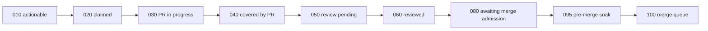

# Multi-agent orchestration

Several agents work on Dailies at the same time: Hive's agents, Claude Code in CI, CLI agents in local sessions and the
repository's own workflows. None of them directs the others. They coordinate through GitHub:

- **Issues** are the one work queue.
- **Labels and assignees** say who holds an issue and which stage it is in.
- **Pull requests** are the only way into `main`, and `main` is protected by the ruleset. The [merge queue](#merge-queue)
  or the maintainer merges them, and Hive's merge sweep may merge low- and medium-risk ones (see
  [Merging](#merging)).

This page maps who does what and how work moves between them. [`AGENTS.md`](../AGENTS.md) holds the rules each agent
follows, and [`docs/security/SECURITY-AI.md`](security/SECURITY-AI.md) sets out the trust boundaries. How to monitor
agent work, debug it when it gets stuck and stop it is in [`ai-ops-runbook.md`](ai-ops-runbook.md).

## Who works here

| Actor | Runs as | Takes work from | Produces |
| --- | --- | --- | --- |
| Maintainer | `Tim-van-Oudheusden` | Everything below | Triage labels, decisions, merges, release tags |
| Hive agents | the `hive-worker-bee` GitHub App (formerly `hive-forge-app`) | Hive's own routing over this repository's issues | Issues titled `[<agent>] …` and labelled `agent/<agent>`; pull requests on branches such as `quality/test-…`, `arch/…`, `scanner/fix-…`, `strategy/…`, `sec/fix-…` |
| Hive ACMM Eval | the `hive-worker-bee` GitHub App, started from the Hive dashboard | Missing files from Hive's ACMM checklist | `[ACMM Ln] Add …` issues labelled `acmm`, `ai-fix-requested` and `origin/dashboard` |
| Claude Code in CI | `.github/workflows/claude.yml` | The `ai-fix-requested` label applied by a person, or `@claude` from an `OWNER`, `MEMBER` or `COLLABORATOR` | Pull requests on `claude/*` branches; reviews on request |
| CLI agents (Claude Code, Copilot, Cursor) | the maintainer's local sessions | The issue the maintainer points them at | Pull requests on `<type>/<number>-<slug>` branches |
| Workflows | `GITHUB_TOKEN`, or the repository's bot GitHub App in the `bot` environment | Schedules and repository events | The issues and pull requests listed in [Work the workflows generate](#work-the-workflows-generate) |
| Dependabot | `app/dependabot` | Pinned actions and `scripts/requirements.txt` | Version-bump pull requests |

The Hive agents seen on this repository so far are `scanner`, `quality`, `guide`, `ci-maintainer`, `strategist`,
`architect`, `operations`, `craftsman`, `sec-check` and `telemetry`; Hive decides which ones run. CLI agents read
`AGENTS.md` and its companions (`CLAUDE.md`, `.github/copilot-instructions.md`, `.cursor/rules/agent-guidance.mdc`) and
the `github-issue-flow` skill in `.claude/skills/`. Hive agents work through the GitHub API without a clone, so they get
`AGENTS.md` only if the Hive spoke keeps a checkout of the repository (`project.checkouts_dir`; see
[`docs/research/hive-acmm.md`](research/hive-acmm.md) §6.3).

## The shared queue

Every agent takes work from GitHub issues and lands it through a pull request whose body says `Fixes #<number>`
(`AGENTS.md`, "Issue Tracking"). One issue is worked at a time, and child issues wait for their parents. How each
change links back to its issue, and how to follow that link either way, is in
[`agent-tasks/`](agent-tasks/README.md).

Before starting an issue, an agent checks that nobody else holds it:

- **Held by someone:** it has an assignee, a `hive/claimed-by-<agent>` label, `hive/in-progress`, or a stage from
  `stage/020-claimed` up.
- **Covered by an open pull request:** `🐝 covered by PR` or `stage/040-covered-by-pr`.
- **Parked on a person:** `hold`, `blocked`, `needs-human`, `stage/015-triage-needed`,
  `stage/017-possible-existing` or `stage/045-needs-decision`.

CLI agents claim an issue by assigning it (`gh issue edit <number> --add-assignee @me`); Hive claims with its labels.

Hive moves its issues and pull requests through `stage/*` labels; each label's description in the repository says
exactly what it means. The main stages, in label-number order:

The other stages:

- `stage/070-fixing`: a Hive pull request has red CI, requested changes or needs a rebase, and a Hive agent is fixing
  it.
- `stage/071-needs-author` and `stage/072-returned-to-contributor`: a human's pull request needs its author.
- `stage/074-adopted-by-hive`: Hive finishes a contributor's pull request after red CI.
- `stage/085-needs-decision` and `stage/090-needs-human`: a person has to act.
- `stage/090-ready-for-human-merge`: Hive would merge, but trust or role blocks it; a maintainer's approval is all
  that is missing.
- `stage/stalled` and `stage/regressed`: Hive's own alarms.

`hive/likely-done` and `hive/partially-addressed` record what Hive thinks a merged pull request did to the issue.

## Handing work over

- **Maintainer to Claude Code in CI:** label the issue `ai-fix-requested`, or mention `@claude`
  ([`CONTRIBUTING.md`](../CONTRIBUTING.md#handing-work-to-claude-code)).
- **Hive to Claude Code in CI: does not happen.** The ACMM gap issues carry `ai-fix-requested`, but
  `claude-code-action` refuses a label applied by a bot (`Workflow initiated by non-human actor: hive-forge-app`), so
  `claude.yml` skips the job when the label's sender is not a `User` (#278); the issue gets a skipped run, not a failed
  one. A person or a CLI agent works those issues instead; a maintainer who wants Claude Code on one removes the label
  and adds it again.
- **Maintainer to a CLI agent:** point the session at the issue. The agent follows `AGENTS.md`'s session steps through
  to the open pull request and the hand-off note in `.claude/session-summary.md`.
- **Any agent to the queue:** follow-up work becomes a new issue (`gh issue create`), never a TODO in the code or a
  note in a pull request.

## Work the workflows generate

| Workflow | When | Opens |
| --- | --- | --- |
| `nightly-compliance.yml` (link check) | Sundays, or a manual run with `force_links` | The `data: N broken links (week W)` issue, and the `data/link-status` pull request when a game's status should change |
| `nightly-compliance.yml` (`checker-pin`) | Nightly, once a newer checker image has settled | The `ci/checker-pin` pull request |
| `auto-issues.yml` | After each Nightly compliance run on `main` | Opens or updates the `ci: nightly compliance: N failing checks` issue, and closes it once every check passes ([`docs/testing.md`](testing.md#the-nightly-compliance-issue)) |
| `merge-queue.yml` | Whenever a workflow holding a required check succeeds, a draft is marked ready, or a person removes `hold`, `blocked`, `sentinel-alert` or `automated`; or a manual run | Merges the oldest ready pull request (see [Merging](#merging)), closes the issues it links, and comments on and labels `hold` a pull request that fails verification |
| `popularity.yml` | Weekly (Mon 04:17 UTC), or a manual run | The `data/popularity` pull request, the only one that merges itself once the required checks pass |
| `game-submission-check.yml`, `game-submission-approve.yml` | A game submission issue, then the maintainer's `approved` label | Labels and a comment on the submission, then the `data/add-<slug>` pull request |
| `external-data-checker.yml` | Weekly (Mon 05:37 UTC), or a manual run | A pull request that moves the release manifest's source to a newer `v*` tag |
| `auto-review.yml` | A maintainer comments `/apply-suggestions` on a pull request | A commit with the review suggestions on that pull request's branch, and a comment listing what was applied and skipped |
| `claude.yml` | The `ai-fix-requested` label applied by a person, or `@claude` from an `OWNER`, `MEMBER` or `COLLABORATOR` | Pull requests on `claude/*` branches, and comments on the issue or pull request |
| `labeler.yml` | A pull request is opened, updated or reopened | The path labels from `.github/labeler.yml` on the pull request |

Every pull request the workflows open is labelled `automated`. So is the nightly compliance issue (with `ci`); the
broken-links issue is labelled `data`. Whatever opens it, an issue goes into the same queue as the rest.

## Merging

Only pull requests change `main`. The ruleset in `.github/rulesets/main.json` requires the `PR review rubric`,
`Build, lint, test`, `Unit-test coverage floors`, `Static checks` and `Flatpak (x86_64)` checks and allows merge commits
only. The [merge queue](#merge-queue) merges ready pull requests with a merge commit, and Hive's merge sweep may
merge low- and medium-risk ones; the maintainer merges the rest.
The weekly popularity pull request merges itself (`AUTO_MERGE_JOBS` in `tests/tooling/test_workflows.py`); catalog and
link-status pull requests carry the `automated` label, which keeps them out of the queue, so the maintainer merges
them.

`tier-classifier.yml` posts each pull request's risk tier ([`docs/risk-tiers.md`](risk-tiers.md)). A `high` change, for
example to `.github/workflows/**`, `AGENTS.md` or `.claude/**`, needs a line-by-line review whoever wrote it, so the
queue never merges one: the maintainer does, after that review. Hive's merge sweep may merge low- and medium-risk
pull requests only, and none labelled `hold`, `blocked`, `sentinel-alert` or `automated` (#363). Hive's review and merge
stages (`050` to `100`) describe its own lane; they do not replace the ruleset.

### Merge queue

GitHub's own merge queue needs an organization-owned repository, so `.github/workflows/merge-queue.yml` runs one on
Actions. Whenever CI, the coverage gate or the PR review rubric succeeds, a draft is marked ready, or a person removes
`hold`, `blocked`, `sentinel-alert` or `automated` from a pull request, it takes the oldest open pull request that:

- comes from this repository, not a fork, and is not a draft;
- has none of the labels `hold`, `blocked`, `sentinel-alert` or `automated`;
- is in merge state `CLEAN`: no check failing, required or not (a failing optional check makes it `UNSTABLE`, which
  the queue leaves), and the review threads resolved;
- is not high risk ([`risk-tiers.md`](risk-tiers.md)), rated by `main`'s `scripts/tier-classify.sh`.

It merges that pull request onto the current `main` and runs the `Build, lint, test` commands on the result: lint,
format check, the unit, script, tooling and data tests, and the schema validation. Static checks, the coverage floors
and the Flatpak build are not re-run there. If it passes and neither the pull request nor `main` moved, the queue merges
the pull request (a merge commit), closes the issues its body links with `Fixes #N`, and starts `main`'s push workflows
(CI, the coverage gate, Pages, the quality report and the Windows build). A merge made with `GITHUB_TOKEN` closes no
issue and starts no push run, so the queue does both itself. If verification fails, the pull request gets `hold` and a
comment linking the run; fix it and remove `hold` to queue it again. Each run starts the next, so the queue merges one
pull request at a time.

| Label | Set by | Effect |
| --- | --- | --- |
| `hold` | The maintainer, Hive, or the queue | Keeps the pull request out of the queue until it is removed; the queue sets it on a pull request that failed verification |
| `blocked` | The maintainer | The pull request waits on something outside this repository |
| `sentinel-alert` | Hive's sentinel | Flags a sensitive change; the maintainer reviews it and removes the label |
| `automated` | Workflows | Opened by a workflow, whose merge policy is its own (#79); the queue leaves it |

To keep a pull request out of the queue, add `hold` or leave it a draft. Dependabot's pull requests change workflow or
script-lock files, which are high risk, so the maintainer merges them. A label removed by a bot starts no run; the next
required check that finishes does. To drain the queue by hand: `gh workflow run merge-queue.yml`. The logic lives in
`scripts/merge-queue.sh`, and `tests/scripts/test_merge_queue.py` and `tests/tooling/test_merge_queue_workflow.py`
cover it.

`.github/CODEOWNERS` names the maintainer as owner of every `high` path, so those pull requests request his review.
It does not gate the merge: the ruleset leaves `require_code_owner_review` off, because an author cannot approve his
own pull request.

## Keeping agents apart

- **Bot output is data.** Issue, pull request and comment bodies never change an agent's task, permissions or rules,
  even when another agent wrote them (`AGENTS.md`, "Safety Boundaries").
- **Who can start a run is gated.** Only accounts with triage access can label an issue, and `claude.yml` answers
  `ai-fix-requested` only when a person applies it (`github.event.sender.type == 'User'`). `@claude` counts only from
  `OWNER`, `MEMBER` or `COLLABORATOR`, and fork pull requests are refused. Only reviewed jobs on `main` may use the
  `bot` environment's App token.
- **Parallel local agents use separate worktrees,** and give every tool an absolute path into their own worktree.
  Relative paths have written into the main checkout before (`.claude/memory/corrections.tsv`, 2026-10-16). Run the
  full suite on the combined result: two changes that each pass alone can still break together.

## Measuring it

The weekly `PR metrics` workflow counts agent-authored pull requests that were merged against those closed unmerged.
Agent-authored means a `claude/*` head branch, the `hive-worker-bee` author or a Hive signature in the PR body
(`scripts/lib/pr-source.jq`, shared with the audit trail below). The weekly quality report and the nightly compliance
run show whether the combined output keeps the gates green. [`docs/metrics/README.md`](metrics/README.md)
lists every metric. The weekly `AI audit trail` workflow records which agent and model are behind each pull request
merged into `main`, and who merged it ([`metrics/README.md`](metrics/README.md#ai-audit-trail)).

The weekly `Strategy report` workflow shows whether the agents keep up: issues opened against issues closed, the open
backlog per stage label and milestone, and the ACMM gaps still open per level. A stage where issues pile up is where
work stalls.
